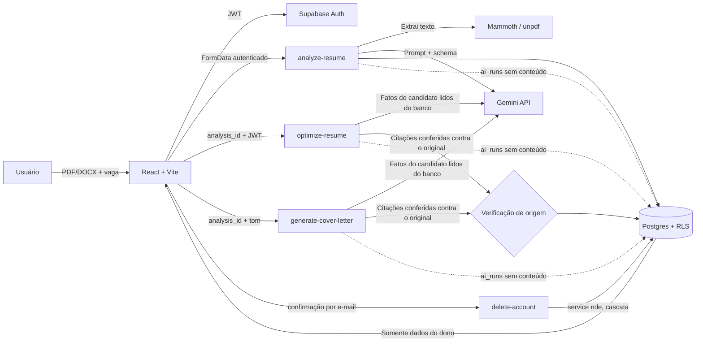

<div align="center">
  

  # Matchly

  **Currículos mais relevantes. Carreiras mais próximas.**

  A Matchly compara um currículo com uma vaga, explica a aderência entre os dois e gera uma versão mais direcionada para recrutadores e sistemas ATS — sem inventar experiências, habilidades ou resultados.

  [](https://react.dev/)
  [](https://www.typescriptlang.org/)
  [](https://supabase.com/)
  [](https://ai.google.dev/)
</div>

---

## Sobre o produto

Enviar o mesmo currículo para vagas diferentes reduz a relevância da candidatura. Adaptá-lo manualmente exige tempo, leitura cuidadosa e conhecimento de como recrutadores e sistemas ATS interpretam o documento.

A Matchly transforma esse processo em um fluxo simples:

1. O usuário envia seu currículo em PDF ou DOCX.
2. Cola a descrição completa da vaga.
3. Recebe score de aderência, pontos fortes, gaps e palavras-chave ausentes.
4. Responde, se quiser, "Tenho essa experiência" para os gaps que de fato cobre.
5. Gera uma versão otimizada e uma carta de apresentação para aquela vaga.
6. Vê, frase por frase, de onde cada afirmação veio (currículo original ou resposta do próprio usuário) e quais merecem conferência.
7. Baixa em PDF ou DOCX.

> **Princípio inegociável:** a IA pode melhorar a forma como uma trajetória é apresentada, mas nunca inventar uma trajetória.

## Demonstração

<table>
  <tr>
    <td width="66%"></td>
    <td width="34%"></td>
  </tr>
  <tr><td align="center"><strong>Fluxo de análise</strong></td><td align="center"><strong>Experiência mobile</strong></td></tr>
</table>

A landing page possui motion orientado ao produto, revelações por scroll, microinterações e suporte a `prefers-reduced-motion`. A interface funciona desde 320 px até telas desktop amplas.

## Funcionalidades

### Implementadas

#### Fluxo principal

- Landing page comercial responsiva (sem promessas que o produto não mede).
- Login por e-mail para usuários convidados; lista de acesso validada no backend antes de qualquer chamada à IA.
- Upload de **PDF ou DOCX** (até 5 MB), com validação do tipo real do arquivo e extração de texto no servidor.
- Análise de aderência com Gemini: score com rubrica, pontos fortes, gaps e palavras-chave.
- **Perguntas para fechar gaps:** o usuário descreve experiências que a vaga pede e que o currículo não mostra; as respostas entram como fatos informados por ele.
- **Currículo otimizado** e **carta de apresentação** (tom profissional ou próximo) para a vaga.
- **Fidelidade verificável:** a IA cita o trecho literal que sustenta cada afirmação; o servidor confere a citação e reprova números novos. A tela mostra a origem de cada frase, o resumo "X de Y com origem comprovada" e uma aba com o original.
- Exportação em **PDF** e **DOCX** (texto selecionável, uma coluna, segura para ATS) e cópia da carta.
- **Histórico** de análises com URLs próprias (`/analises/:id`), reabertura e exclusão.

#### Proteção e conformidade

- Cota diária por usuário (análises, otimizações e cartas) e defesa contra prompt injection.
- Isolamento de dados por usuário com Row Level Security.
- Termos de Uso e Política de Privacidade (rascunho até revisão jurídica), consentimento no login e aviso claro sobre o envio ao Gemini.
- **Minha conta:** baixar todos os dados (JSON) e excluir a conta com confirmação, apagando tudo em cascata.

#### Qualidade e operação

- Retry progressivo e fallback de modelo durante indisponibilidades da IA.
- Testes unitários, testes de ponta a ponta com acessibilidade (axe) e CI no GitHub.
- Observabilidade básica: registro técnico de cada chamada de IA e `npm run metrics`.

### Roadmap

- Recuperação de senha e login social (dependem de provedor de e-mail e configuração do Google).
- Planos, cobrança e Pix.
- Registro de aceite dos termos (data e versão) na abertura pública.
- Prazo de retenção de dados e exclusão automática de contas inativas.
- Rastreador de candidaturas, extensão de navegador e otimização de LinkedIn.

## Arquitetura



### Decisões técnicas

- **Nenhuma chave privada no cliente:** `GEMINI_API_KEY` existe apenas nas Edge Functions.
- **Autorização em profundidade:** as funções validam explicitamente o access token e o banco aplica RLS.
- **IA com saída estruturada:** o Gemini retorna JSON com `responseSchema`, temperatura baixa e rubrica de score; o servidor valida e normaliza a resposta.
- **Verdade verificável, não só prometida:** cada afirmação do currículo e da carta precisa citar um trecho literal do original (ou da resposta do usuário). O servidor confere a citação, reprova números novos e tenta de novo uma vez; o que não tem prova é marcado na tela.
- **Dados não confiáveis no prompt:** vaga, currículo e respostas entram dentro de tags neutralizadas e o prompt de sistema manda ignorar instruções contidas neles.
- **Lógica pura e testável:** validação, verificação de origem, cotas e telemetria ficam em `supabase/functions/_shared`, sem APIs do Deno, e são testadas com Vitest.
- **Resiliência:** erros `429`, `500`, `502`, `503` e `504` recebem retry exponencial e fallback.
- **Falha segura:** sem backend configurado, o fluxo funcional permanece bloqueado.

## Stack

| Camada | Tecnologia | Responsabilidade |
| --- | --- | --- |
| Interface | React 19 + TypeScript | Fluxos, estados e componentes |
| Build | Vite 6 | Desenvolvimento e bundle |
| Design | CSS + Phosphor Icons | Sistema visual, motion e responsividade |
| Autenticação | Supabase Auth | Cadastro, login e sessões |
| Banco | Supabase Postgres | Currículos, análises e resultados |
| Segurança | PostgreSQL RLS | Isolamento por usuário |
| Backend | Supabase Edge Functions | Parsing, validação e IA |
| IA | Gemini 3.6 Flash | Análise e otimização |
| Fallback | Gemini 3.5 Flash-Lite | Continuidade em picos de demanda |
| Parsing | Mammoth e unpdf | Extração de DOCX e PDF |
| Exportação | docx e jsPDF | Geração de DOCX e PDF no navegador |
| Rotas | React Router | URLs próprias para análise, otimizado, carta e conta |
| Testes | Vitest, Playwright e axe | Unitários, ponta a ponta e acessibilidade |
| CI | GitHub Actions | Tipos, testes, build, `deno check` e e2e em cada PR |
| Hospedagem | Vercel (front) e Supabase (banco e funções) | Publicação |
| QA visual | Playwright | Screenshots desktop e mobile |

## Executando localmente

### Pré-requisitos

- Node.js 20+ e npm 10+.
- Projeto Supabase para o fluxo real.
- Chave Gemini configurada somente no Supabase.

```bash
git clone https://github.com/matheusesdev/matchly.git
cd matchly
npm install
```

Crie o arquivo de ambiente:

```bash
cp .env.example .env.local
```

No Windows PowerShell:

```powershell
Copy-Item .env.example .env.local
```

Preencha apenas as variáveis públicas:

```env
VITE_SUPABASE_URL=https://seu-projeto.supabase.co
VITE_SUPABASE_PUBLISHABLE_KEY=sua-chave-publicavel
```

Inicie o frontend:

```bash
npm run dev
```

A aplicação estará disponível em `http://localhost:5173`.

## Configurando o Supabase

```bash
npx supabase login
npx supabase link --project-ref SEU_PROJECT_REF
npx supabase db push
```

Cadastre os secrets — nunca no `.env` do frontend:

```bash
npx supabase secrets set \
  GEMINI_API_KEY=SUA_CHAVE \
  GEMINI_MODEL=gemini-3.6-flash \
  GEMINI_FALLBACK_MODEL=gemini-3.5-flash-lite \
  MVP_ALLOWED_EMAILS=voce@email.com,outro-convidado@email.com \
  ALLOWED_ORIGINS=https://seu-site.vercel.app
```

`ALLOWED_ORIGINS` (origens do front separadas por vírgula) é obrigatório em produção: sem ela, as funções só aceitam `localhost`. Opcionalmente, ajuste as cotas diárias com `QUOTA_ANALYZE_PER_DAY` (padrão 5), `QUOTA_OPTIMIZE_PER_DAY` (10) e `QUOTA_COVER_LETTER_PER_DAY` (10).

Publique as funções:

```bash
npx supabase functions deploy analyze-resume --no-verify-jwt
npx supabase functions deploy optimize-resume --no-verify-jwt
npx supabase functions deploy generate-cover-letter --no-verify-jwt
npx supabase functions deploy delete-account --no-verify-jwt
```

**Ordem de publicação:** migrations primeiro (`db push`), depois as funções, e por último o front. Uma função nova pode depender de coluna ou tabela nova, e o front pode consultar uma tabela que ainda não existe.

O gateway não valida o JWT porque as funções fazem a validação explícita com `auth.getUser(accessToken)`. Requisições sem sessão válida continuam sendo rejeitadas. A variável `MVP_ALLOWED_EMAILS` é obrigatória e aceita e-mails separados por vírgula; se estiver ausente ou vazia, as funções falham de forma segura sem chamar o Gemini.

Enquanto o MVP estiver fechado, desative também **Allow new users to sign up** em **Authentication > Sign In / Providers > Email** no painel do Supabase. A lista no backend é a barreira que protege o custo da API; desabilitar novos cadastros evita contas desnecessárias.

## Modelo de dados

- **`resumes`:** nome do arquivo, texto extraído, hash do conteúdo (reaproveita o mesmo currículo), proprietário e criação.
- **`analyses`:** vaga, score, palavras-chave, gaps, pontos fortes, texto otimizado, origem das frases (`evidence`), respostas do candidato (`user_facts`), carta e sua origem.
- **`usage_events`:** uma linha por uso, para aplicar a cota diária.
- **`ai_runs`:** registro técnico de cada chamada de IA (resultado, tentativas, fidelidade, duração), sem conteúdo pessoal.

Todas as tabelas possuem RLS. Um usuário autenticado acessa somente registros cujo `user_id` corresponde ao próprio ID, e todas apagam em cascata com a conta.

## Segurança e privacidade

- `.env` e `.env.local` são ignorados pelo Git.
- A chave Gemini nunca é enviada ao navegador.
- Toda operação de IA exige uma sessão válida e um e-mail presente na lista de convidados do backend.
- Currículos são processados no backend.
- Uploads aceitam somente PDF ou DOCX de até 5 MB, conferidos pelos primeiros bytes do arquivo (não só pela extensão).
- Descrições de vaga possuem limite de 8.000 caracteres e currículos de 20.000.
- CORS restrito às origens configuradas em `ALLOWED_ORIGINS`.
- Cota diária por usuário para proteger o custo da IA.
- Exclusão de conta pela própria pessoa, com confirmação por e-mail, apagando tudo em cascata.
- Prompts proíbem invenção de cargos, datas, empresas, métricas, habilidades e credenciais, e o servidor reprova números que não existam no original.

> **Antes de abrir ao público:** revisão jurídica dos Termos e da Política de Privacidade (depois, `VITE_LEGAL_REVIEWED=true`), identificação do responsável em `VITE_LEGAL_CONTROLLER_NAME` e `VITE_LEGAL_CONTACT_EMAIL`, e confirmação do plano da API do Gemini quanto ao uso dos dados enviados.

## Qualidade

### Verificações automáticas

| Comando | O que garante |
| --- | --- |
| `npm run typecheck` | Tipos do front-end. |
| `npm test` | Testes unitários (Vitest): validação da IA, verificação de origem, cotas, exportação PDF/DOCX, textos legais. |
| `npm run build` | Build de produção (inclui checagem de tipos). |
| `npm run test:e2e` | Testes de ponta a ponta (Playwright) com o Supabase simulado em `e2e/support.ts`, incluindo acessibilidade WCAG 2 A/AA (axe) e layout em 360 px. Não precisam de `.env` nem de rede. |
| `npm run check:functions` | Tipos das Edge Functions (`deno check`); exige o [Deno](https://deno.com) instalado. |

Na primeira execução dos testes de ponta a ponta, instale o navegador: `npx playwright install chromium`.

O workflow [`ci.yml`](.github/workflows/ci.yml) roda tudo isso em cada pull request e em cada push na `main`.

### Observabilidade

Cada chamada de IA grava uma linha em `ai_runs` (tipo, resultado, tentativas, fidelidade e duração; **sem** conteúdo de currículo, vaga ou e-mail) e emite um log estruturado nas Edge Functions (painel do Supabase > Edge Functions > Logs). Para ver as métricas agregadas:

```bash
npm run metrics
```

Mostra volume por dia, taxa de falhas por tipo, **qualidade da verificação de origem** (fidelidade média, p10 e mediana; abaixo de 0,6 o app regenera uma vez), latência (p50/p95) e bloqueios por cota. As consultas ficam em [`supabase/metrics.sql`](supabase/metrics.sql) e usam a CLI do Supabase já logada e vinculada ao projeto.

### QA visual

Com o servidor local em execução:

```bash
node scripts/capture-linkedin.mjs
```

O Playwright gera screenshots em `artifacts/linkedin`. As capturas usam `prefers-reduced-motion` para produzir imagens estáticas consistentes.

### Checklist manual

- Login e logout de uma conta convidada; rejeição de uma conta fora da lista.
- Upload válido, formato incorreto e arquivo acima de 5 MB.
- Vaga vazia, curta e próxima ao limite.
- Análise completa com persistência.
- Otimização sem fatos ausentes no original.
- Sessão expirada e requisição sem autenticação.
- Indisponibilidade do Gemini e fallback.
- Layout em 320 px, 390 px, tablet e desktop.
- Teclado e redução de movimento.

## Estrutura

```text
matchly/
├── .github/workflows/         # CI (tipos, testes, deno check, e2e)
├── artifacts/linkedin/        # Screenshots e texto de divulgação
├── e2e/                       # Testes de ponta a ponta e acessibilidade (Playwright + axe)
├── scripts/                   # Métricas e automação de QA visual
├── src/
│   ├── components/            # Landing, login, histórico, otimizado, carta, conta e páginas legais
│   ├── lib/                   # Supabase, API tipada, histórico, exportação PDF/DOCX
│   ├── legal/                 # Identificação do responsável pelos textos legais
│   ├── App.tsx                # Rotas e telas do fluxo principal
│   └── *.css                  # Design, motion e responsividade
├── supabase/
│   ├── functions/             # Edge Functions e _shared (lógica pura testável)
│   ├── migrations/            # Schema, índices e RLS
│   └── metrics.sql            # Consultas de observabilidade
├── tests/                     # Testes unitários (Vitest)
├── .env.example
├── AGENTS.md
└── package.json
```

## Princípios

1. **Verdade antes de persuasão:** melhorar a comunicação sem fabricar qualificações.
2. **Privacidade por padrão:** cada usuário acessa apenas os próprios dados.
3. **Orientação antes de automação:** explicar score e gaps antes de gerar.
4. **Acessibilidade como requisito:** responsividade, foco e redução de movimento.
5. **Erros acionáveis:** toda falha explica o que aconteceu e como continuar.

## Status

MVP fechado para convidados, com o fluxo completo implementado: enviar PDF ou DOCX, analisar aderência, fechar gaps, gerar currículo e carta com origem verificável, baixar em PDF/DOCX e gerenciar os próprios dados. Pagamentos e recuperação de senha seguem no roadmap, e a abertura pública depende da revisão jurídica e das decisões listadas acima.

---

<div align="center">Desenvolvido com foco em produto, segurança e uma experiência de candidatura mais relevante.</div>
